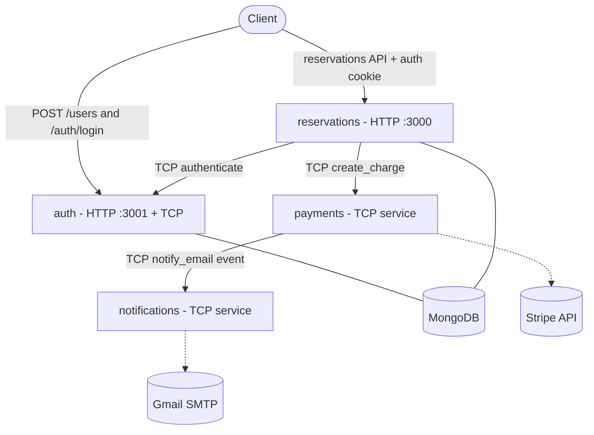

# Sleepr

[](./LICENSE)

A hotel reservation backend built as a **NestJS monorepo of microservices**. A client authenticates against the auth service, then books reservations; the reservations service charges a card through Stripe and triggers a confirmation email — each concern isolated in its own service that communicates over TCP.

> This is a reference/practice project demonstrating NestJS monorepos, TCP microservice transport, MongoDB persistence, JWT cookie auth, Stripe payments, and transactional email.

## Architecture



### Services

| Service           | Transport          | Responsibility                                                                                             |
| ----------------- | ------------------ | ---------------------------------------------------------------------------------------------------------- |
| **auth**          | HTTP `:3001` + TCP | User registration, login (issues a JWT in an httpOnly cookie), and validating tokens for other services.   |
| **reservations**  | HTTP `:3000`       | Public API for reservations. Guards requests with JWT, orchestrates payment, persists bookings to MongoDB. |
| **payments**      | TCP only           | Creates Stripe PaymentIntents from card details. Emits an email event on success.                          |
| **notifications** | TCP only           | Sends transactional email through Gmail OAuth2 via Nodemailer.                                             |

### Messaging contract

Communication between services uses NestJS TCP transport with `@nestjs/microservices`.

| Pattern         | Type                    | Producer → Consumer      | Payload                                              |
| --------------- | ----------------------- | ------------------------ | ---------------------------------------------------- |
| `authenticate`  | request/response        | reservations → auth      | `{ Authentication: <jwt> }` → `UserDto`              |
| `create_charge` | request/response        | reservations → payments  | `CreateChargeDto` + `email` → Stripe `PaymentIntent` |
| `notify_email`  | event (fire-and-forget) | payments → notifications | `{ email, text }`                                    |

### Booking flow

1. `POST /auth/login` (email + password) sets an httpOnly `Authentication` cookie containing a JWT.
2. `POST /reservations` is guarded by `JwtAuthGuard`, which sends the token to **auth** over TCP (`authenticate`) and attaches the returned user to the request.
3. The reservations service sends `create_charge` to **payments**, which creates the card `PaymentMethod` and a confirmed `PaymentIntent` via Stripe.
4. On success, payments emits `notify_email`; **notifications** sends the confirmation email.
5. The reservation is persisted to MongoDB with the Stripe invoice id.

## Tech stack

- **Framework:** [NestJS 11](https://nestjs.com/) (monorepo mode)
- **Language:** TypeScript 5
- **Database:** MongoDB via Mongoose
- **Messaging:** NestJS TCP transport
- **Auth:** Passport (local + JWT), `@nestjs/jwt`, bcrypt hashing, httpOnly cookies
- **Payments:** Stripe
- **Email:** Nodemailer (Gmail OAuth2)
- **Logging:** pino (`nestjs-pino` + `pino-http`)
- **Validation:** `class-validator`, `class-transformer`, `joi` for env validation
- **Testing:** Jest + Supertest
- **Packaging:** Docker / Docker Compose, Yarn

## Repository layout

```
apps/
  auth/            HTTP + TCP service (users, login, token validation)
  reservations/    HTTP gateway + TCP clients (booking orchestration)
  payments/        TCP service (Stripe charges)
  notifications/   TCP service (email)
libs/
  common/          Shared library (@app/common): database, logger, auth guard,
                   decorators, DTOs, service tokens
docker-compose.yml  Local multi-service + MongoDB stack
```

The shared library is imported as `@app/common` (see `tsconfig.json` paths and the `common` project in `nest-cli.json`).

## Prerequisites

- Node.js 18+
- Yarn 1.x
- MongoDB (local instance or the provided Docker Compose service)
- A Stripe account (secret key) for payments
- A Google account with OAuth2 credentials + refresh token and a Gmail address for notifications

## Getting started

### 1. Install dependencies

```bash
yarn install
```

### 2. Configure environment files

Each service reads its own `.env` file (loaded by `@nestjs/config` and validated with Joi at boot). Create one per app: `apps/<service>/.env`.

**apps/auth/.env**

| Variable        | Description                                              |
| --------------- | -------------------------------------------------------- |
| `MONGODB_URI`   | MongoDB connection string                                |
| `JWT_SECRET`    | Secret used to sign JWTs                                 |
| `JWT_EXPIREION` | JWT lifetime in seconds (note: spelling as used in code) |
| `HTTP_PORT`     | HTTP port (e.g. `3001`)                                  |
| `TCP_PORT`      | TCP microservice port                                    |

**apps/reservations/.env**

| Variable                          | Description                         |
| --------------------------------- | ----------------------------------- |
| `MONGODB_URI`                     | MongoDB connection string           |
| `PORT`                            | HTTP port (e.g. `3000`)             |
| `AUTH_HOST` / `AUTH_PORT`         | Address of the auth TCP service     |
| `PAYMENTS_HOST` / `PAYMENTS_PORT` | Address of the payments TCP service |

**apps/payments/.env**

| Variable                                    | Description                                        |
| ------------------------------------------- | -------------------------------------------------- |
| `PORT`                                      | TCP microservice port                              |
| `NOTIFICATIONS_HOST` / `NOTIFICATIONS_PORT` | Address of the notifications TCP service           |
| `STRIPE_SEVRET_KEY`                         | Stripe secret key (note: spelling as used in code) |

**apps/notifications/.env**

| Variable                     | Description                  |
| ---------------------------- | ---------------------------- |
| `PORT`                       | TCP microservice port        |
| `SMTP_USER`                  | Gmail address used as sender |
| `GOOGLE_OAUTH_CLIENT_ID`     | Google OAuth2 client id      |
| `GOOGLE_OAUTH_CLIENT_SECRET` | Google OAuth2 client secret  |
| `GOOGLE_OAUTH_REFRESH_TOKEN` | Google OAuth2 refresh token  |

### 3. Run

**Locally** (start MongoDB first, then each service in its own terminal):

```bash
yarn start:dev auth
yarn start:dev reservations
yarn start:dev payments
yarn start:dev notifications
```

**With Docker Compose:**

```bash
docker compose up --build
```

This builds and starts all four services plus MongoDB. The `reservations` service is exposed on `:3000` and `auth` on `:3001`.

## API

Base URL: `http://localhost:3000` (reservations) / `http://localhost:3001` (auth).

| Method   | Path                | Auth                   | Description                                   |
| -------- | ------------------- | ---------------------- | --------------------------------------------- |
| `POST`   | `/users`            | —                      | Register a user (`email`, strong `password`). |
| `GET`    | `/users`            | JWT cookie             | Return the current user.                      |
| `POST`   | `/auth/login`       | Local (email/password) | Log in and set the `Authentication` cookie.   |
| `POST`   | `/reservations`     | JWT cookie             | Create a reservation (charges the card).      |
| `GET`    | `/reservations`     | —                      | List reservations.                            |
| `GET`    | `/reservations/:id` | —                      | Get one reservation.                          |
| `PATCH`  | `/reservations/:id` | —                      | Update a reservation.                         |
| `DELETE` | `/reservations/:id` | —                      | Delete a reservation.                         |

Example request body for `POST /reservations`:

```json
{
  "startDate": "2026-01-01T15:00:00.000Z",
  "endDate": "2026-01-05T11:00:00.000Z",
  "charge": {
    "amount": 250,
    "card": {
      "number": "4242424242424242",
      "cvc": "123",
      "exp_month": 12,
      "exp_year": 2030
    }
  }
}
```

## Scripts

| Command                | Description                                 |
| ---------------------- | ------------------------------------------- |
| `yarn build`           | Build all apps (`nest build`).              |
| `yarn start:dev <app>` | Run a service in watch mode.                |
| `yarn start:prod`      | Run the built reservations app from `dist`. |
| `yarn lint`            | Lint and auto-fix TypeScript.               |
| `yarn format`          | Format sources with Prettier.               |
| `yarn test`            | Run unit tests.                             |
| `yarn test:e2e`        | Run the reservations e2e suite.             |
| `yarn test:cov`        | Run tests with coverage.                    |

## Security notes

Dependencies are pinned/overridden in the `resolutions` block of `package.json` to keep transitive packages on patched versions. To re-check:

```bash
yarn audit
```

## License

Released under the [MIT License](./LICENSE).
